# User Flows & Navigation — Tuanis Carpooling

> Source: Figma file `gsw0VhFa56qIAcVPcYKjxg`, explored on 2026-11-13 (read-only).
> These flows come from the **prototype interactions** in the file (408 links on Móvil, about 600 on Web, all extracted programmatically), cross-checked against the screen content. Links that are missing, contradictory or look like prototype shortcuts are flagged and not "fixed".
> Related docs: [design-system.md](design-system.md) · [screens-inventory.md](screens-inventory.md) · [components-inventory.md](components-inventory.md) · [assets-inventory.md](assets-inventory.md)

## 0. Users & platforms

| Actor | Platform | Evidence |
|-------|----------|----------|
| **Pasajero** (passenger) | Mobile app | Search, join request, my trips, history |
| **Conductor** (driver) | Mobile app | Vehicles, publish trip, requests, trip execution |
| A user can be **both** | Mobile app | "Rol" multi-select in Registro/Perfil. Variants Perfil - Conductor / Pasajero / Ambos. History shows trips as Conductor and as Pasajero. |
| **Administrador** | Web portal | "Portal administrativo", "Acceso exclusivo para personal autorizado" |

Prototype flow starting points defined in Figma (Móvil page only): `Flow 2` → Inicio de sesión (`2081:3`), `Flow 3` → Registro (`2102:1801`), `Flow 4` → Lista carros viajes (`2390:1976`), `4.4.4 Búsqueda y detalle de viaje` → Menu Home (`2467:2462`). The Web page has no flow starting points.

---

## 1. Mobile navigation structure

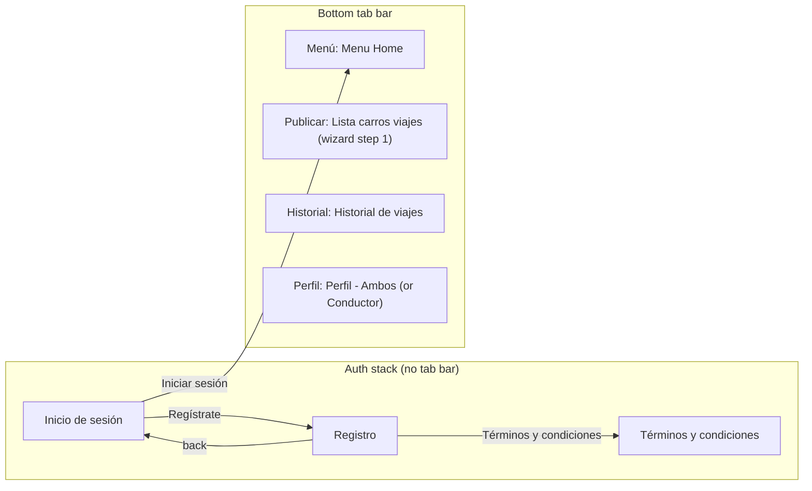

**Tab bar targets (from prototype):** `tab/home` → Menu Home · `tab/services` → Lista carros viajes · `tab/activity` → Historial de viajes · `tab/account` → Perfil - Ambos (from Menu Home it goes to Perfil - **Conductor**).

Flags:
- The labels say "Menú / Publicar / Historial / Perfil", but the layer names are `home / services / activity / account`.
- In the Publicar flow and the Perfil screens the bar is drawn with **Perfil** active. The active state is not reliable in the design.
- On some screens (Punto 3, Punto 4 Resultados/Detalle, Buscar rutas) only `tab/home` is wired.
- "Mis viajes" is **not a tab**. It is reached from the Home shortcut.

---

## 2. Mobile flows

### 2.1 Authentication
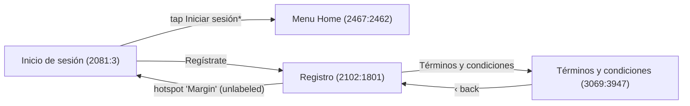
\* In the prototype the whole login background is the hotspot. There is no validation, no error state and no "forgot password" on mobile. The **Registrar** button has no prototype link. There is no logout anywhere in the mobile app.

### 2.2 Passenger: search → join a trip
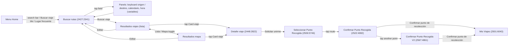
Notes:
- Buscar rutas uses Figma variables to simulate state: `busqueda/origen` "TEC Cartago", `busqueda/destino` "San José", `busqueda/fecha` "Hoy", `busqueda/hora` "6:30 a. m.", and booleans `tecladoOrigen`, `tecladoDestino`, `calendarioAbierto`, `horaAbierta`. Tapping a **Lugar guardado** sets a variable (presumably the destination) and opens Buscar rutas.
- After confirming the pickup point the request is created. Mis Viajes then shows the trip with status **Pendiente/Aprobado/Cancelado**. How the passenger learns about approval is **not designed** (no notifications screen).

### 2.3 Passenger: my trips
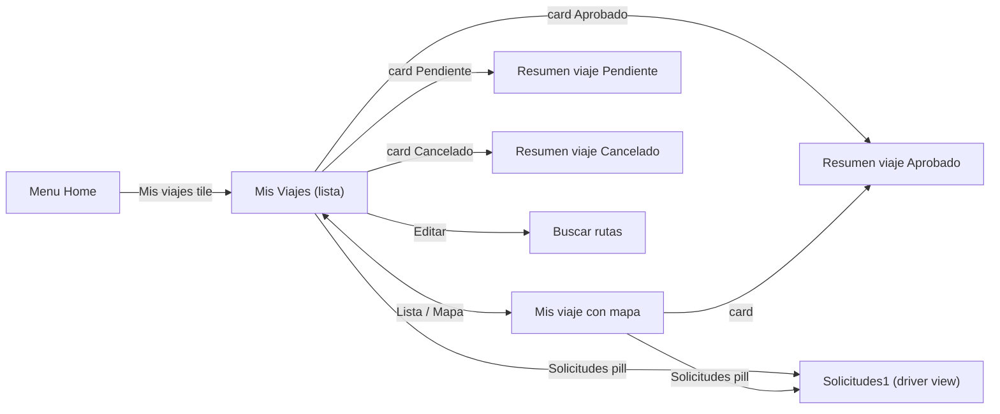
Flags:
- The Resumen screens have no actions (no cancel-my-request button). Only back and tabs work.
- The **Solicitudes** pill on *Mis Viajes* opens the driver's incoming-requests screen. So "Mis Viajes" mixes passenger trips with a driver entry point. To clarify with product.

### 2.4 Driver: publish a trip (wizard)
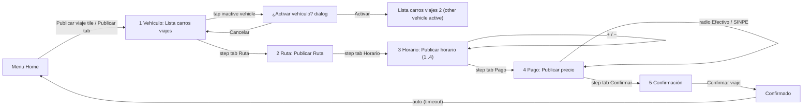
Notes:
- Navigation between steps uses the **step tabs** (any step can be reached from any other). There are no "Siguiente" buttons.
- Header back from any step goes to **Menu Home**, not to the previous step.
- Stepper bounds: 1 to 4 ("Máximo permitido: 4 pasajeros", presumably the vehicle capacity).
- Only "Publicar precio 1" (SINPE selected) links to Confirmación.
- The capacity shown in Confirmación ("3 pasajeros") doesn't match the stepper. That's sample data.
- The FAB "+" on the vehicle list has no link. Presumably it means "add vehicle", see 2.7.

### 2.5 Driver: manage requests → run the trip
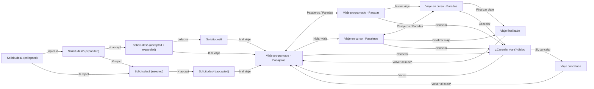
\* **Prototype shortcut:** "Volver al inicio" links back to *Viaje programado – Pasajeros*, not to Home. The label suggests Home. Also, "Cancelar" is offered while the trip is **en curso**, and the dialog copy assumes a scheduled trip.

Not designed:
- How a driver reaches *Viaje programado* other than through Solicitudes (e.g. a list of "my published trips").
- How requests reach the driver (notifications).

### 2.6 Trip history
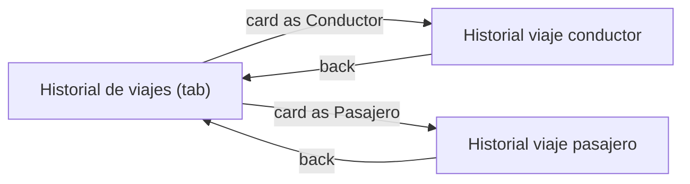

### 2.7 Profile & vehicles
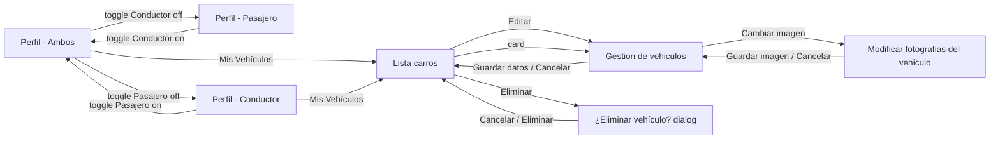
Flags:
- "Mis Vehículos" appears only when the Conductor role is selected.
- **Agregar vehiculo** has no direct link. The photo screen is titled "Agregar vehículo" while being reached from "Cambiar imagen". The add-vehicle flow is ambiguous.
- **Guardar Cambios** on Perfil has no link.
- There is no logout and no avatar-photo flow beyond the badge.

---

## 3. Web admin portal navigation

### 3.1 Shell
Sidebar (present on every authenticated screen):
- **Análisis**
  - Consultas generales → `228:142` (tab 1)
  - Estadísticas → `285:483`
- **Gestión**
  - Instituciones → `270:36`
  - Usuarios → `259:13`
  - Parámetros → `271:254` (Métodos de Pago)
- **Cerrar sesión** → Login `277:600`

Header: Bell (hover state only, no notifications panel designed) and user chip (hover only, no menu designed).

### 3.2 Authentication & password recovery
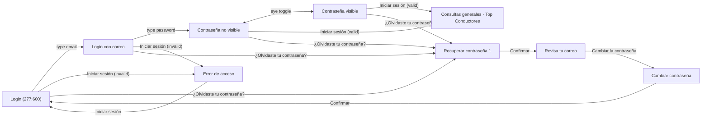
- Login uses variables `correoIngresado`, `contraseñaIngresada` (STRING) and `mostrarError` (BOOLEAN) with a **conditional** interaction on the button. In other words, the prototype simulates validation.
- "Recordarme" has no behavior designed.
- "Revisa tu correo" says the email sending is simulated in the prototype. In the real flow, step 3 would be reached through an emailed link.

### 3.3 Consultas generales (6 queries)
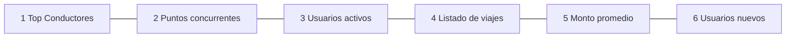
- The tab pills navigate between the 6 frames (every tab links to every other).
- Filters: **Institución** opens the `Menú Plegable` overlay. **Desde/Hasta** open the `Dropdown calendar` overlay. **Restablecer filtros** has a hover state only.
- *Listado de viajes*: "Ver detalles ⌄" expands a row (component `2287:3249` with 6 expanded-row variants). The expanded content was not reviewed visually.
- *Monto promedio*: hovering a bar shows tooltips `Promedio1–4`.

### 3.4 Estadísticas
- Filters as above, plus the gender dropdown (`Menú generos` overlay) on the age-range card.
- No drill-down interactions.

### 3.5 Instituciones
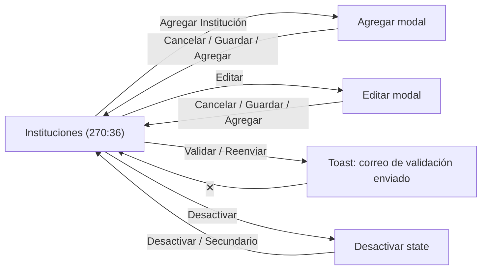
- Validation lifecycle per institution, as seen in the rows: **validated ✓** → (none) · **Validar** (not yet sent) · **Reenviar** (sent, waiting) · **N/A** (inactive institution).
- Active institutions show Editar + Desactivar. Inactive ones show Editar (dark) + Activar.
- The prototype wiring is overlapping and noisy: several "Primario" hotspots point to different overlays. The list above is the cleaned-up intent.

### 3.6 Usuarios
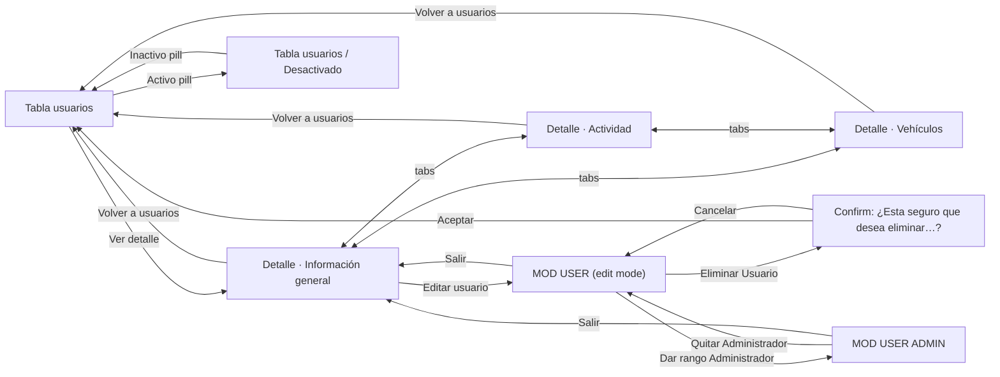
- The search box, institution filter and pager have no designed behavior beyond the static frames.
- The field-level pencil icons in edit mode have no designed inline-edit state.

### 3.7 Parámetros (5 catalogs, same flow each)
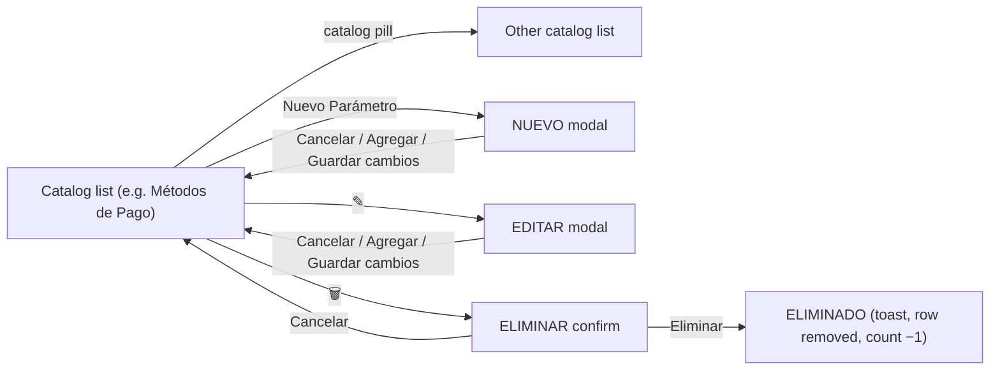
- The modals include a **Catálogo** select, so the catalog can presumably be changed inside the modal.
- "Buscar parámetro…" and "Todos los estados" have no designed behavior.
- In the Métodos de Pago frames, the **Nuevo Parámetro** header button links to the NUEVO modal of the current catalog.

---

## 4. Gaps & open questions (not invented, listed for decision)

| # | Area | Gap |
|---|------|-----|
| 1 | Mobile auth | No login error/validation, forgot-password, logout or email-verification screens |
| 2 | Mobile roles | How does a pure passenger become a driver (only via the Perfil role toggle)? What does the Publicar tab do for a passenger-only user? |
| 3 | Mobile driver | No list of "my published trips" and no entry to *Viaje programado* except via Solicitudes |
| 4 | Mobile notifications | Request approval, trip cancellation ("Avisamos a los pasajeros") and new requests have no notification UI |
| 5 | Mobile passenger | No cancel-request action from Resumen viaje |
| 6 | Mobile vehicles | Add-vehicle flow ambiguous (button unlinked; photo screen titled "Agregar vehículo") |
| 7 | Mobile ratings/verification | "Verificada TEC" badge shown, but no verification flow |
| 8 | Mobile maps | All maps are static images. Real map interaction (pan, pick point) is implied but not specified. |
| 9 | Web | No notifications panel (Bell), no user menu, no pagination/search behavior, no empty/loading/error states for tables and charts |
| 10 | Web Instituciones | Meaning of "Validar"/"Reenviar"/"N/A" inferred from labels only |
| 11 | Web Usuarios | Edit-mode field editing is not designed beyond pencil icons |
| 12 | Both | No empty states, loading states or offline/error states anywhere |
| 13 | Mobile driver | On "Solicitudes", each card shows a route with accept/reject, but when expanded it lists several passengers and a total earning. Is a card one passenger's request or a whole trip? (`IncomingRequest` in `src/types/trip.ts` models the screen literally for now.) |
